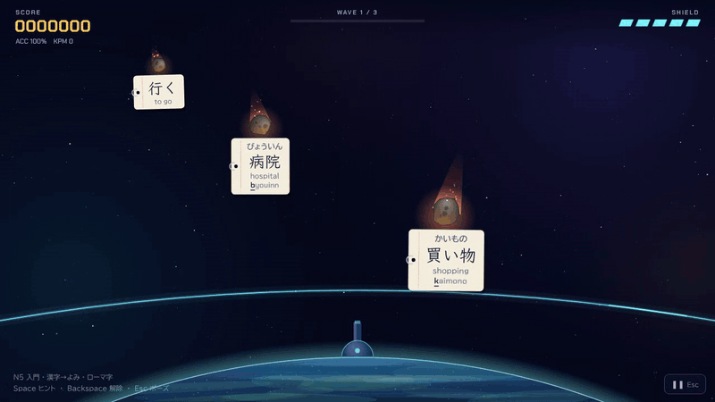
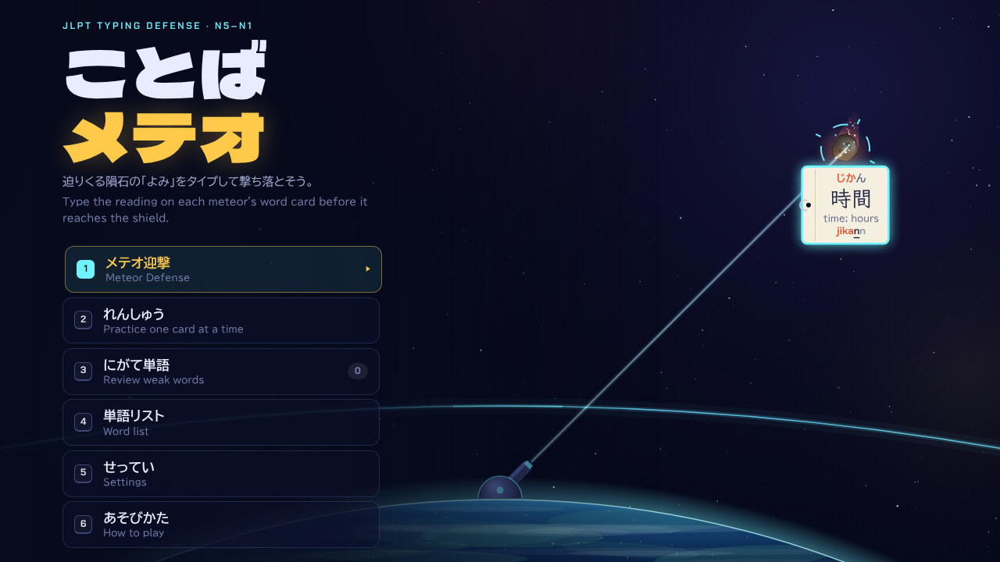
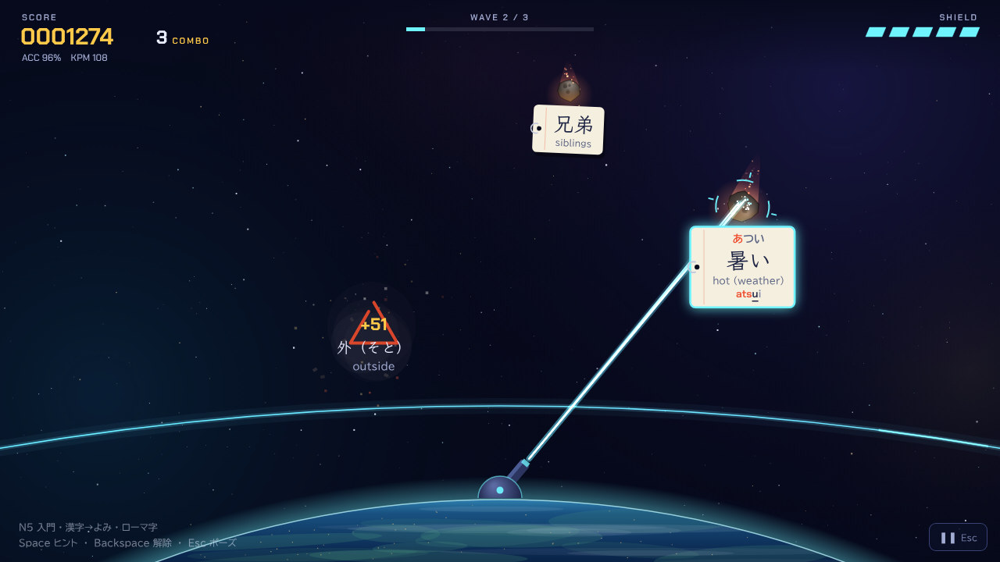
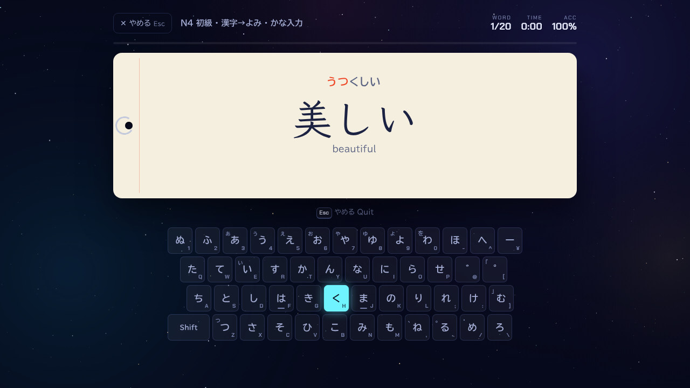
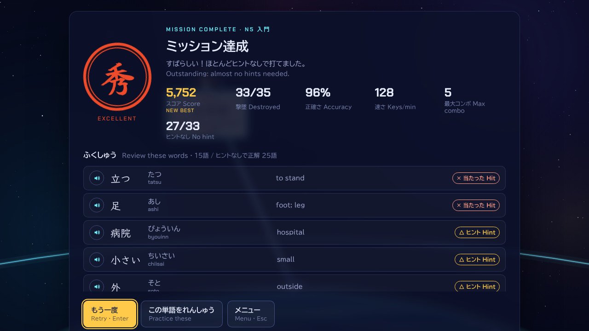

<div align="center">

# ことばメテオ · Kotoba Meteor

迫りくる隕石の「よみ」をタイプして撃ち落とす、JLPT学習者のためのタイピングゲーム。<br>
A typing game for learners of Japanese: type the reading on each meteor's word card before it reaches the shield.

**[▶ ブラウザで遊ぶ · Play in your browser](https://kotoba-meteor.pages.dev)**



</div>

## 遊ぶ · Play

**https://kotoba-meteor.pages.dev** をパソコンのブラウザで開くだけで遊べます。インストールは不要です。キーボードが必要です。

Open **https://kotoba-meteor.pages.dev** in a desktop browser. Nothing to install; a physical keyboard is required.

オフラインで遊ぶときは、このリポジトリを **Code → Download ZIP** でダウンロードし（または `git clone`）、`docs/index.html` を開いてください。ゲームは1つのHTMLファイルです。<br>
To play offline, download this repository (**Code → Download ZIP**, or `git clone`) and open `docs/index.html`. The whole game is one HTML file.

## 特長 · Features

| 日本語 | English |
|---|---|
| かな・N5〜N1・四字熟語の **944語** | **944 words** across kana, JLPT N5–N1 and four-character idioms |
| ローマ字入力は shi/si、chi/ti、n/nn、っ（kk・xtu）、sha/sya など、IMEで通るつづりをすべて受け付ける | Romaji input accepts every spelling an IME accepts: shi/si, chi/ti, n/nn, っ as a doubled consonant or xtu, sha/sya, and more |
| JISかな入力にも対応。濁音は「か」＋「゛」の2打（日本語キーボード用） | JIS kana input, with voiced kana typed as か then ゛ (Japanese keyboard) |
| ふりがなは「いつも／あとから／なし」。出る前に打てばスコア×1.5 | Furigana hints: always, delayed, or off. Type before the reading appears for a ×1.5 bonus |
| 出題は「漢字→よみ」と「英語→ことば」 | Two question types: read the kanji, or recall the word from its English meaning |
| まちがえた単語は「にがて単語」に記録され、次から出やすくなる | Missed and hinted words are saved as weak words and come back more often |
| 練習モードでは、次に押すキーをキーボード図で表示 | Practice mode lights the next key on an on-screen keyboard |
| 撃ち落とした単語を読み上げる（ブラウザの日本語音声） | Words are read aloud with the browser's Japanese voice |
| 外部ライブラリも素材ファイルもなし。効果音とBGMもWeb Audioで生成 | No libraries and no asset files: sound effects and music are synthesized with Web Audio |

<table>
  <tr>
    <td></td>
    <td></td>
  </tr>
  <tr>
    <td align="center">タイトル · Title</td>
    <td align="center">メテオ迎撃 · Meteor Defense</td>
  </tr>
  <tr>
    <td></td>
    <td></td>
  </tr>
  <tr>
    <td align="center">れんしゅう（JISかな入力） · Practice with kana input</td>
    <td align="center">結果と復習リスト · Results and review list</td>
  </tr>
</table>

## あそびかた · How to play

隕石についた単語カードの「よみ」を最後まで打つと、レーザーで爆破できます。3ウェーブのあとに、単語を3つ持った巨大隕石が来ます（N3以上は最後が四字熟語）。シールドに当たると1ダメージで、5回当たると終わりです。当たった単語は、その場で読みと意味が表示されます。結果は秀・優・良・可・不可で評価されます。

Type the reading on a meteor's word card to the end and the laser destroys it. Three waves are followed by a giant meteor carrying three words (at N3 and above the last one is a four-character idiom). Each meteor that reaches the shield costs one of five cells, and the reading and meaning of a word you missed appear on the spot. Missions are graded on the traditional Japanese scale 秀・優・良・可・不可 (excellent to fail).

| キー · Key | 動作 · Action |
|---|---|
| 文字キー · Letters | よみを入力 · Type the reading |
| `Space` | ヒント（ふりがなを表示） · Show the reading |
| `Backspace` | ねらいを解除 · Release the current target |
| `Esc` | ポーズ · Pause |

| レベル · Level | 語数 · Words | 例 · Examples |
|---|---:|---|
| かな · Kana | 104 | いぬ、テレビ、ありがとう |
| N5 | 186 | 学校、電車、食べる |
| N4 | 175 | 経験、地震、届ける |
| N3 | 179 | 宇宙、環境、諦める |
| N2 | 129 | 維持、把握、蓄える |
| N1 | 141 | 斡旋、緻密、培う |
| 四字熟語 · Idioms | 30 | 一石二鳥、試行錯誤 |

## 開発 · Development

```
src/              ゲーム本体（編集するのはここ） · the game source
  data.js         語彙。1行 = 単語|よみ|意味 · vocabulary, one "word|reading|meaning" per line
  engine.js       ローマ字・JISかなの入力判定、学習記録 · romaji and JIS kana matching, learning records
  audio.js        効果音・BGM・読み上げ · sound effects, music, read-aloud
  game.js         Canvasでの描画とミッション進行 · canvas rendering and the mission loop
  ui.js           画面遷移・練習モード・結果 · screens, practice mode, results
  index.html, style.css
build.py          src/ を docs/index.html の1ファイルにまとめる · inlines src/ into docs/index.html
tests/            入力判定と語彙の検証、ブラウザでの自動プレイ · matcher/vocabulary tests and a browser play-through
docs/             ビルド済みのゲームとREADME用の画像 · the built game and README images
```

```bash
python3 build.py            # src/ → docs/index.html
python3 build.py --check    # docs/index.html が最新か確認 · fail if docs/index.html is stale
node tests/engine.test.js   # 全単語がローマ字（別つづり含む）とJISかなで打てるか · every word is typeable both ways
```

公開は Cloudflare Pages です（ビルドコマンドなし、出力ディレクトリ `docs`）。`main` に push すると自動で更新されます。<br>
The site is hosted on Cloudflare Pages with no build command and `docs` as the output directory, so every push to `main` redeploys it.

ブラウザでの自動プレイテスト（Playwright）· Browser play-through test:

```bash
npm install --no-save playwright && npx playwright install chromium
node tests/e2e.js
```

### 単語を追加する · Adding words

`src/data.js` の該当レベルに `単語|よみ|English meaning` を1行足し、`python3 build.py` と `node tests/engine.test.js` を実行します。テストは、追加した単語が両方の入力方式で最後まで打てるかを確認します。

Add a line `word|reading|English meaning` to the right level in `src/data.js`, then run `python3 build.py` and `node tests/engine.test.js`. The test checks that the new word can be typed to the end in both input methods.

## 注記 · Notes

- JLPTのレベル分けは目安です。2010年以降、公式の語彙リストは公開されていません。<br>JLPT levels are approximate: no official vocabulary lists have been published since 2010.
- 日本語能力試験（JLPT）を実施する国際交流基金・日本国際教育支援協会とは関係ありません。<br>This project is not affiliated with the Japan Foundation or JEES, which administer the JLPT.
- 記録（にがて単語・ハイスコア）はブラウザの中だけに保存されます。<br>Progress (weak words, best scores) is stored only in your browser.
- フォント BIZ UDPGothic、Klee One、Dela Gothic One、Chakra Petch、Yuji Syuku は、Google Fonts から SIL Open Font License で実行時に読み込みます。<br>Fonts are loaded at runtime from Google Fonts under the SIL Open Font License.

## ライセンス · License

[MIT](LICENSE) © 2026 Yudai Nishiyama
